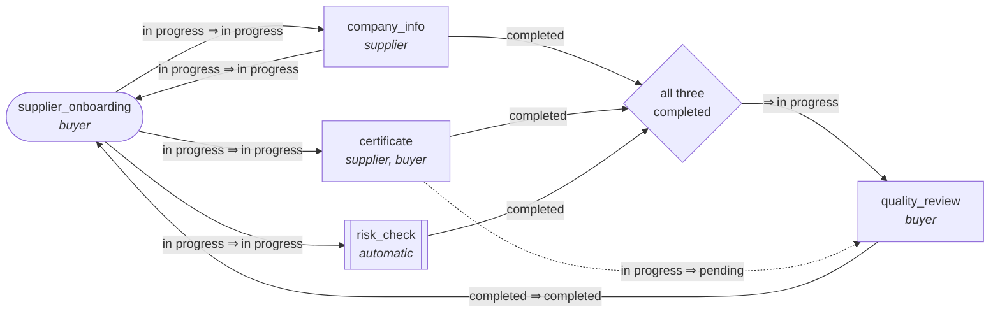

# Workflow Engine

A workflow and its tasks each have a state. **Links** say how a change in one causes changes in
others. The engine applies those changes, runs automatic tasks in the background, records who
changed what and why, and checks who may change what. It runs behind a small HTTP API.

## The challenge

This is my solution to a time-boxed take-home challenge: design a workflow engine for
long-running business processes. The brief, in short:

- A **workflow** and each of its **tasks** have their own state.
- **Links** connect a source component (workflow or task) to one or more targets, with rules
  for how a state change in the source changes the targets, e.g. "when task A moves to in
  progress, move task B to in progress".
- Changing a workflow's state affects its linked tasks; changing a task's state affects linked
  tasks or the workflow.
- Any state may move to any other, including back to an earlier one. Links decide what follows.
- Rules can be linear, parallel (one change fans out to several), or conditional (a merge point
  that fires only when several tasks reach a given state).
- The program must create running instances of a defined workflow and its tasks, update their
  states, and cascade the changes through the links. Model one business process to demonstrate
  it.
- Focus on approach, architecture and readable, extensible code over completeness. Document how
  it works, the assumptions, and how to run it. Tests and a diagram are a bonus.

The brief's example was a user onboarding flow (sign up, verify email, add profile). I modelled
supplier onboarding instead, because it has two real roles and gives permissions a purpose.

## Quick start

Needs [uv](https://docs.astral.sh/uv/) (it installs Python 3.14) and `make`.

```bash
make setup      # install dependencies
make check      # lint, type checks, tests
make run        # API on http://127.0.0.1:8000, docs at /docs
make live-test  # in a second terminal: sample scenarios against the running API (needs curl, jq)
```

## Example: supplier onboarding

The supplier fills in company info and a certificate while the system runs an automatic risk
check. When all three are done, the buyer does a quality review, which completes onboarding.
The buyer can send the certificate back, and the review then waits for it again.



Each arrow is a link: *when the source enters this state ⇒ move the target to that state*.
Under each name: the roles that may change it by hand. Defined in
[`workflow/definitions.py`](workflow/definitions.py).

| Kind of rule | Example |
|---|---|
| Linear | A completed review completes onboarding |
| Fan-out | Starting onboarding starts the three tasks |
| Two-way | Starting company info starts onboarding, and the reverse |
| Merge | The review starts only when all three tasks are completed |
| Going back | Sending the certificate back resets the review to pending |

## How it works

**Model** ([`workflow/models.py`](workflow/models.py))

| Class | What it is |
|---|---|
| `WorkflowDefinition` | The template: tasks, links, and who may edit what. No state, so one definition runs for many suppliers. |
| `Workflow` | One running instance: its own state, its tasks, and the history. |
| `Task` | One task of a running workflow. It owns its state. |
| `Link` | Plain data: `source` + `on` (the trigger), `then` (targets and new states), optional `only_if` (states others must be in). `join()` builds a merge. |
| `Actor` | Who makes a change: `user` + `role`. The `system` actor completes automatic tasks. |

States are `pending`, `in_progress`, `completed` and `failed` (an automatic task that ran out of
attempts). Links can react to any of them.

**Engine** ([`workflow/engine.py`](workflow/engine.py)): `set_state()` is the only way to
change a state.

1. Checks that the actor's role may change the component (403 if not). Changes made by links
   are not checked: whoever wrote the links approved them.
2. Applies the change, then the changes its links trigger, breadth first, so direct effects
   come before effects of effects.
3. Skips a change to the state a component is already in. This stops two-way links from
   looping. A step limit rolls back the whole change if links keep flipping each other (409).
4. Records each change in the history: when, who, from, to, and why (`manual`, a link, or
   `automatic task finished`/`failed`).
5. Once the cascade succeeds, queues a job for each automatic task it moved to in progress.

The cascade never awaits, so on a single event loop no other request can interleave with it.
No locks are needed.

**Automatic tasks.** Jobs wait on an `asyncio.Queue` and a fixed pool of workers runs them, so a
burst of onboardings can't start unlimited work. Each attempt (a random sleep, as pretend work)
has a timeout, and failures are retried with growing waits. The `system` actor then marks the
task `completed`, or `failed` after the last attempt or a crash, and that change cascades like
any other. A job acts only if it is the task's latest run and the task is still in progress:
restarting the task or deleting the workflow cancels a running job and makes a queued one skip.
Workers start and stop with the app; the API never waits for them.

**API** ([`workflow/api.py`](workflow/api.py)), with interactive docs at `/docs`:

| Method | Path | What it does |
|---|---|---|
| `GET` | `/definitions` | List definitions |
| `POST` | `/workflows` | Start one: `{"definition": "supplier_onboarding"}` |
| `GET` | `/workflows`, `/workflows/{id}` | List, or get one with its history |
| `PATCH` | `/workflows/{id}` | Change the workflow's state: `{"state": "in_progress"}` |
| `PATCH` | `/workflows/{id}/tasks/{key}` | Change a task's state: `{"state": "completed"}` |
| `DELETE` | `/workflows/{id}` | Delete |

`PATCH` needs `X-User` and `X-Role` headers, standing in for real authentication. Errors
([`workflow/errors.py`](workflow/errors.py)): 404 for an unknown workflow or task, 403 when the
role may not change it, 409 when a cascade is too long and rolled back, 422 for invalid input.

**Logging** ([`workflow/logs.py`](workflow/logs.py)): standard `logging`. One line per request,
plus every state change and job. A request id tags every line of a request, including the jobs
it starts, so a background change can be traced to its cause.

**Settings** ([`workflow/settings.py`](workflow/settings.py)), from environment variables:

| Variable | Default | Meaning |
|---|---|---|
| `WORKFLOW_MAX_TASK_SECONDS` | `10` | Longest pretend work of an automatic task |
| `WORKFLOW_TASK_FAILURE_RATE` | `0` | How often pretend work fails, 0 to 1 |
| `WORKFLOW_TASK_WORKERS` | `4` | Automatic tasks running at once |
| `WORKFLOW_TASK_TIMEOUT_SECONDS` | `30` | Time limit per attempt |
| `WORKFLOW_TASK_MAX_ATTEMPTS` | `3` | Attempts before a task is marked failed |
| `WORKFLOW_TASK_RETRY_SECONDS` | `1` | Wait before the first retry; doubles after each |
| `WORKFLOW_MAX_CASCADE_STEPS` | `100` | Changes one cascade may make before it is rolled back |
| `WORKFLOW_LOG_LEVEL` | `INFO` | Log level |

**Tests** ([`tests/test_api.py`](tests/test_api.py)): integration tests through the API, one
per kind of rule, plus CRUD, history, permissions, failed and crashed tasks, the worker limit,
and stopping a deleted workflow's job.

## How I used AI

I built this with Claude Code as a pair. I set the scope and the constraints, and Claude
proposed designs, wrote most of the code and tests, and pointed out gaps. I reviewed every
proposal and made each design decision myself: some I accepted as proposed, some I changed,
some came from my own questions. I kept a log of every decision, who proposed it, and the
alternatives considered.

## Assumptions

- Any state can move to any other by hand, including backwards. Links add side effects and
  never block a change. So a buyer can complete the review early. That is a deliberate
  override, limited by permissions and visible in the history.
- Definitions live in code. Running workflows have full CRUD over the API.
- One process, in memory.

## Limits and next steps

- **Storage and jobs** are lost on restart: workflows live in memory and queued jobs are dropped
  at shutdown. Next: Postgres (Django models), and a durable queue that receives jobs after
  the transaction commits (`transaction.on_commit`).
- **Concurrent edits**: the last change wins silently. Next: a version number on the workflow,
  and 409 on a stale one. Several processes would also need a row lock or that version check.
- **Authentication**: the headers are trusted. The engine only needs an `Actor`, so real auth
  would not change it.
- **Guards** (rules that block a manual change) and **definitions over the API** are the
  natural next features.
- **Also**: JSON logs, a history endpoint with filters, CORS and database settings.
